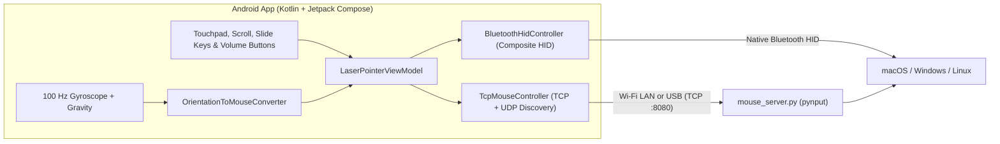

# Bluetooth Laser Pointer

[-3DDC84?logo=android&logoColor=white)](#requirements)
[](#architecture--project-structure)
[-4285F4?logo=jetpackcompose&logoColor=white)](#architecture--project-structure)
[](#connection-modes)

Turn your Android phone into a **100 Hz wireless gyroscope air-mouse, precision trackpad, and presentation clicker** for **macOS, Windows, and Linux**.

Point your phone naturally in the air like a physical laser pointer—or use it eyes-free with hardware volume keys and a built-in trackpad—over **driverless Bluetooth HID**, **Wi-Fi LAN**, or **USB (`adb reverse`)**.

---

## Key Features

### Three Flexible Connection Modes
- **Native Bluetooth HID (Zero Software Required):** Registers your phone as a standard Bluetooth HID 1.11 Composite **Mouse + Keyboard** (`Laser Pointer Pro`). Works out-of-the-box with macOS, Windows, and Linux—no receiver dongle or companion app needed.
- **1-Tap Multi-Computer Switching:** Switch cleanly between paired laptops (e.g., MacBook and Windows PC) directly from the app, with automatic protection against stale host auto-reconnects.
- **Wi-Fi LAN Companion Server (`mouse_server.py`):** Includes **1-tap Wi-Fi auto-discovery** (`Scan Wi-Fi` via UDP broadcast) that finds your computer on the local network and connects automatically over low-latency `TCP_NODELAY`.
- **Conference-Proof USB Mode (`adb reverse`):** Tunnel pointer and slide controls over a USB cable (`127.0.0.1:8080`) when presenting in venues with congested Wi-Fi/2.4 GHz spectrum or restricted Bluetooth policies.

### Gimbal-Lock-Free 3D Air-Mouse Engine
- **Gravity-Referenced 3D Gyroscope Integration:** Projects 100 Hz 3D angular velocity onto the real-world vertical (gravity) and horizontal-right axes via Gram-Schmidt orthogonalization—delivering intuitive horizontal and vertical cursor motion at **any hand posture (0°–110°)** without gimbal lock or magnetometer compass drift.
- **Radial Soft-Knee Tremor Filter:** Suppresses natural resting hand tremor (~0.85°/s) radially in 2D so diagonal movements never snap to the X/Y axes.
- **Δt-Adaptive Smoothing & Pointer Acceleration:** Combines a 14 ms low-pass filter, an ergonomic acceleration curve (1:1 pixel precision for fine aiming + effortless wide sweeps), and lossless sub-pixel remainder accumulation.
- **Sensor Fallback:** Automatically falls back to rotation-vector orientation sensors (with seamless ±180° azimuth wrap handling) on devices without a hardware gyroscope.

### Built for Live Presentations
- **Dual Pointer Activation Modes:**
  - **Hold Trigger:** Cursor moves only while your thumb rests on the central trigger pad—just like holding the button on a hardware laser pointer.
  - **Always On:** Continuous air-mouse tracking with a dedicated **Freeze / Unfreeze** toggle.
- **Hybrid Trackpad + Scroll Strip:** Slide your thumb on the central pad for fine laptop-style trackpad nudges, tap to click, and glide along the right-edge **Vertical Scroll Strip** (`SCRL`) with haptic ticks. Toggle off *Air Gyroscope Motion* anytime to use the app as a pure trackpad + clicker.
- **True Click-and-Drag Buttons:** Dedicated **Left** and **Right** mouse buttons support rapid clicks, double-clicks, and press-and-hold dragging with guaranteed button release.
- **Eyes-Free Volume Key Slide Navigation:** Advance **Next Slide** (`Volume Down`) and **Previous Slide** (`Volume Up`) with tactile haptic feedback while keeping your eyes on the audience.
- **Presentation Quick Keys:** Dedicated **PREV / NEXT** buttons (configurable between `Left`/`Right` Arrows and `PageUp`/`PageDown` for PowerPoint, Keynote, Google Slides, and PDFs), **BLACK** (`B` key to blackout/unblackout slides), **ESC** (exit slideshow), and **CENTER / REZERO**.

---

## Architecture Overview



### Project Structure

| File | Responsibility |
| :--- | :--- |
| `app/.../MainActivity.kt` | Jetpack Compose Material 3 UI, 100 Hz zero-allocation sensor pipeline, custom multi-gesture trackpad/trigger, scroll strip, and hardware volume-key interception |
| `app/.../LaserPointerViewModel.kt` | Unified state management, `SharedPreferences` persistence, and input routing across Bluetooth HID and Server modes |
| `app/.../OrientationToMouseConverter.kt` | Gimbal-lock-free 3D gyroscope projection, radial tremor deadzone, Δt-invariant smoothing, pointer acceleration, and sub-pixel accumulator |
| `app/.../BluetoothHidController.kt` | Android `BluetoothHidDevice` lifecycle, 100 Hz paced HID report queue, paired computer filtering, and 1-tap multi-host switching |
| `app/.../MouseReport.kt` | Standard USB/Bluetooth HID 1.11 Composite Report Descriptor (Report ID 1: 4-byte Relative Mouse + Wheel; Report ID 2: 8-byte Keyboard + LED Output) |
| `app/.../TcpMouseController.kt` | Non-blocking coalesced TCP client (`TCP_NODELAY`) and 1-tap UDP broadcast LAN server discovery |
| `mouse_server.py` | Cross-platform Python companion server (`pynput`) with UDP auto-discovery, packet movement coalescing, Windows Per-Monitor High-DPI awareness, and macOS Quartz/Accessibility integration |

---

## Getting Started

### Requirements
- **Android Device:** Android 12+ (`minSdk = 31`), Bluetooth 4.0+ (for HID mode) and hardware gyroscope recommended.
- **Build Environment:** Android Studio Ladybug+ / JDK 11+ (uses Gradle Wrapper `./gradlew`).
- **Companion Server (Optional — only for Wi-Fi / USB mode):** Python 3.8+ with [`pynput`](https://pypi.org/project/pynput/).

### 1. Build & Install the Android App

Clone the repository and install the debug build via Android Studio or the command line:

```bash
git clone https://github.com/valkozin/BluetoothLaserPointer.git
cd BluetoothLaserPointer
./gradlew installDebug
```

---

## Connection Modes

### Option A: Native Bluetooth HID (Recommended — No Server Needed)

1. Open **Bluetooth Laser Pointer** on your Android phone and select **Bluetooth**.
2. Grant Bluetooth permissions when prompted.
3. Tap **Pair New Mac / Windows PC** to make your phone discoverable, then select your phone in your computer's Bluetooth settings.
4. Once paired, your computer appears in the **Connection** list—tap any paired computer to connect or switch hosts on the fly.

### Option B: Wi-Fi LAN Mode (`mouse_server.py`)

Ideal for desktop PCs without Bluetooth or when you want absolute 1-tap screen-centering (`CENTER`).

1. Install the single Python dependency and start the companion server on your computer:
   ```bash
   pip3 install pynput
   python3 mouse_server.py
   ```
   > **macOS Note:** On first run, grant **Accessibility** permission to your Terminal / IDE under **System Settings → Privacy & Security → Accessibility** so `pynput` can control the cursor and slide keys.
2. In the Android app, switch Connection to **USB / Wi-Fi**.
3. Tap **Scan Wi-Fi** — the app broadcasts a discovery ping on UDP port `8081` and automatically connects to your computer on TCP port `8080` (or enter the displayed LAN IP manually).

### Option C: USB Cable Mode (`adb reverse`)

Zero wireless interference over a standard USB cable:

1. Start the companion server on your computer:
   ```bash
   python3 mouse_server.py
   ```
2. Connect your phone via USB with **USB Debugging** enabled and forward port `8080`:
   ```bash
   adb reverse tcp:8080 tcp:8080
   ```
3. In the Android app, switch to **USB / Wi-Fi**, tap **USB** (sets host to `127.0.0.1`), and tap **Connect**.

---

## Controls & Settings Quick Reference

| Control | Action |
| :--- | :--- |
| **◀ PREV / NEXT ▶** | Previous / Next slide (`Left` / `Right` Arrow by default, or `PageUp` / `PageDown`) |
| **Volume Up / Volume Down** | Eyes-free Previous / Next slide when *Volume Keys Control Slides* is enabled |
| **Touchpad & Trigger Pad** | Hold to aim with wrist (*Hold Trigger* mode), slide thumb for fine trackpad motion, tap to Left Click |
| **SCRL Strip** | Slide finger up/down along the right strip to scroll pages and documents |
| **LEFT / RIGHT** | Tap to click, or **press and hold** `LEFT` while moving to click-and-drag |
| **FREEZE / UNFREEZE** | Temporarily locks air-mouse cursor in place (*Always On* mode) |
| **CENTER / REZERO** | Moves cursor to exact primary screen center (*Server* mode) or resets gyro accumulators (*Bluetooth* mode) |
| **BLACK** | Sends `B` to toggle black screen in PowerPoint, Keynote, and Google Slides |
| **ESC** | Sends `Escape` to exit full-screen slideshow mode |

---

## Running Unit Tests

Unit tests verify the HID Mouse/Keyboard binary report descriptors and the 3D gyroscope motion converter (sub-pixel accumulation, 90° vertical posture without gimbal lock, and ±180° fallback wrap):

```bash
./gradlew testDebugUnitTest
```
